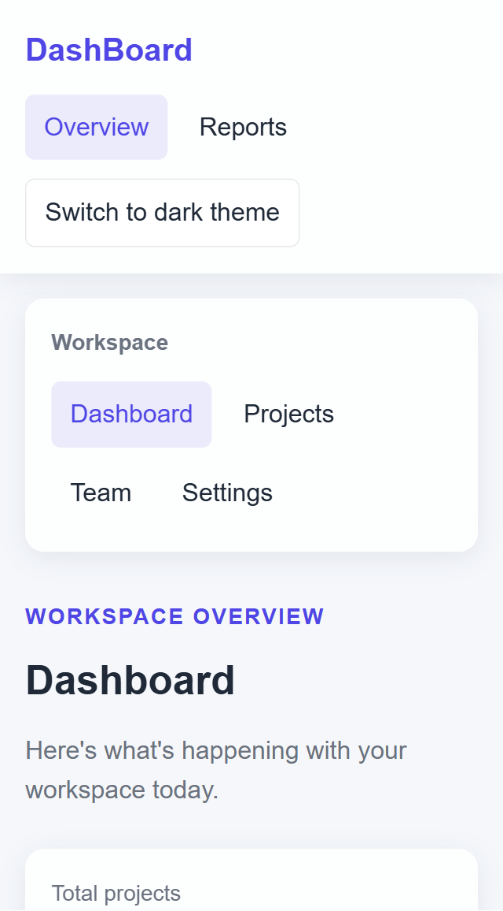
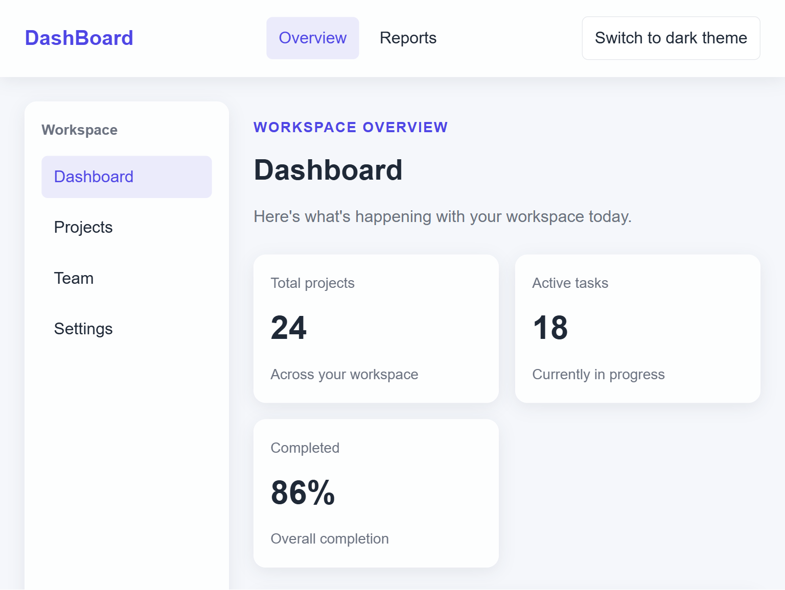
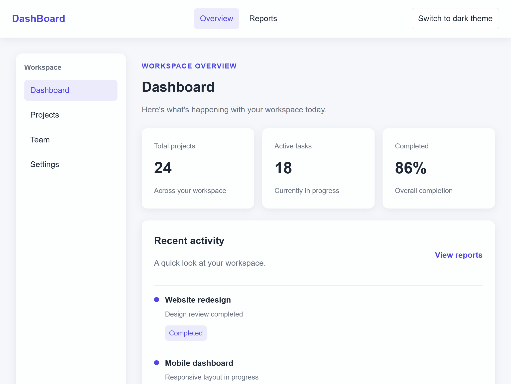
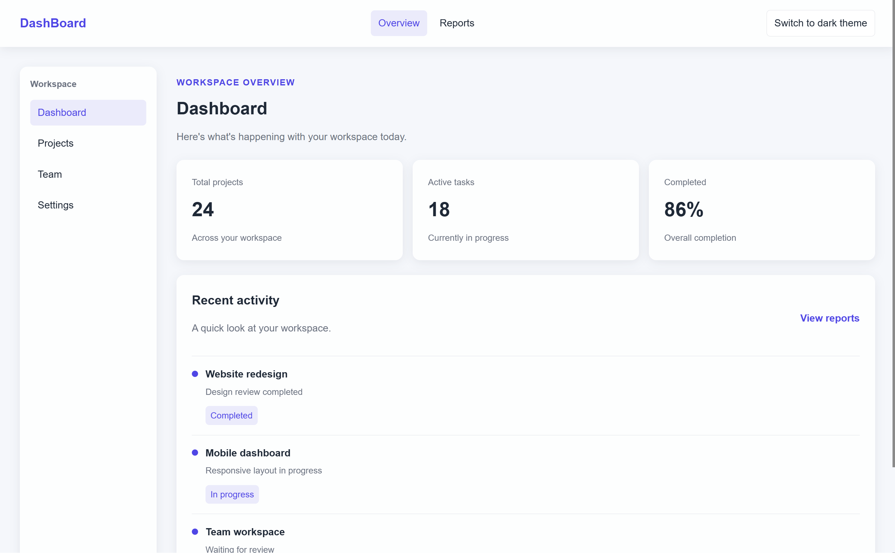
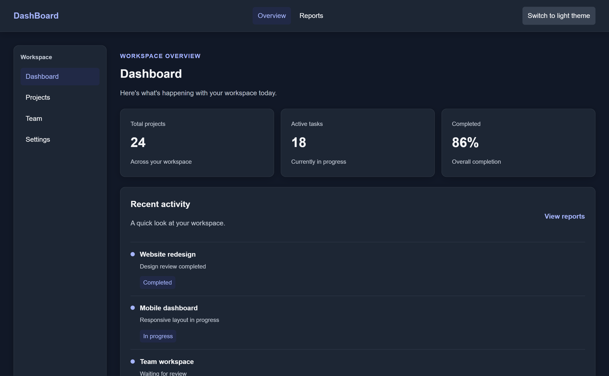

# Responsive Dashboard

A responsive dashboard built with HTML and CSS, demonstrating a mobile-first layout, reusable design tokens, and responsive design principles.

## Features

- CSS custom properties for colors, typography, spacing, borders, and shadows
- Responsive dashboard layout using CSS Grid and Flexbox
- Mobile-first CSS architecture
- Responsive breakpoints at 320px, 768px, 1024px, and 1440px
- Light and dark theme switching
- Subtle glassmorphism, soft shadows, and hover transitions
- Keyboard-visible focus indicators
- Reduced-motion support
- Mobile layout tested at 320px without horizontal scrolling

## Technologies Used

- HTML5
- CSS3
- JavaScript (for theme switching)

## Project Structure

```text
internship_project-3/
├── index.html
├── style.css
├── README.md
└── screenshots/
    ├── mobile-320.png
    ├── tablet-768.png
    ├── desktop-1024.png
    ├── desktop-1440.png
    └── dark-mode.png
```

## Responsive Design

| Breakpoint | Layout |
|---|---|
| 320px and above | Mobile layout |
| 768px and above | Tablet layout |
| 1024px and above | Desktop layout |
| 1440px and above | Large desktop layout |

## Screenshots

### Mobile — 320px


### Tablet — 768px


### Desktop — 1024px


### Large Desktop — 1440px


### Dark Theme


## How to Run

1. Clone or download this repository.
2. Open the project folder in Visual Studio Code.
3. Open `index.html` using the Live Server extension, or open the HTML file directly in your browser.
4. Use the theme toggle button to switch between light and dark themes.

## Purpose

This project demonstrates responsive layout techniques, CSS design tokens, theme customization, and mobile-first styling for a dashboard interface.